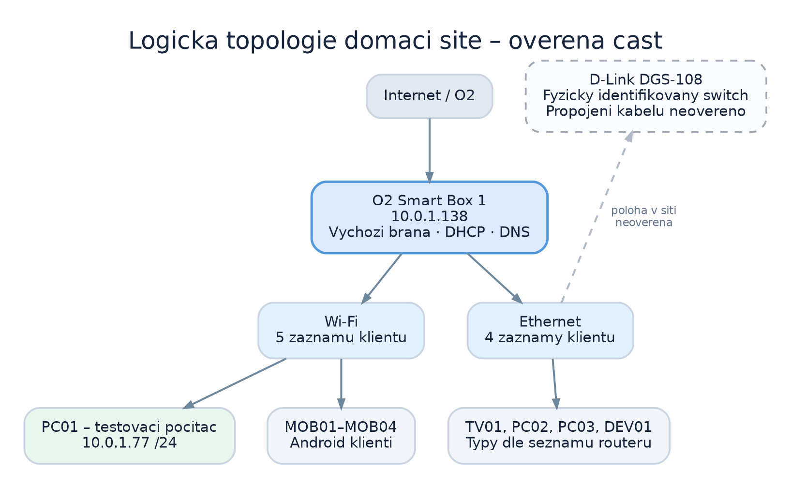
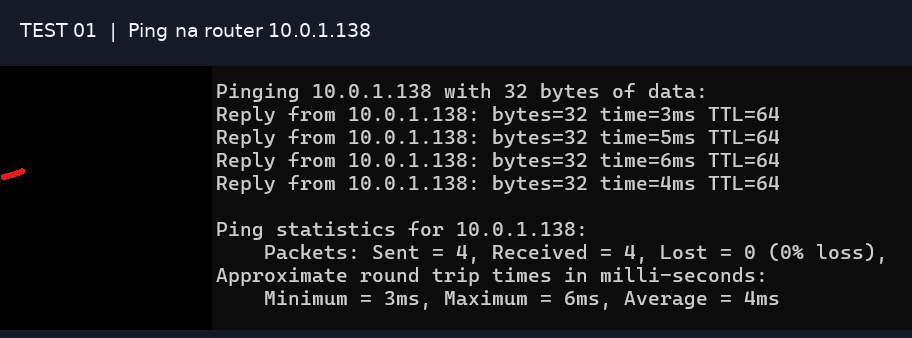
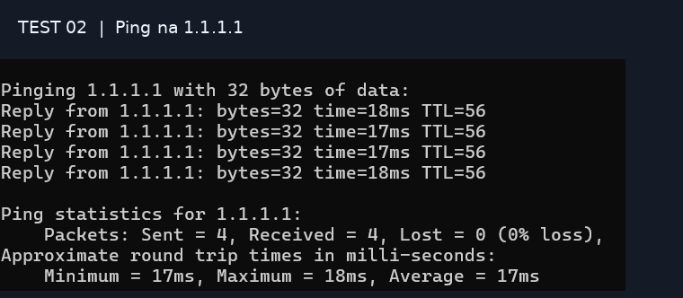
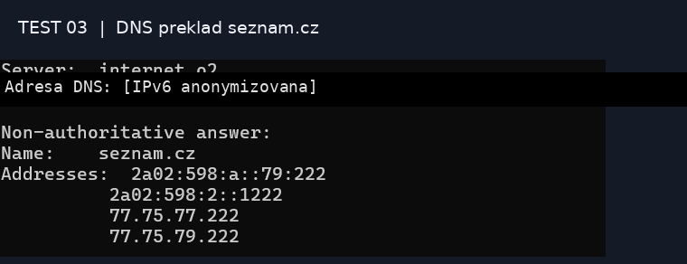
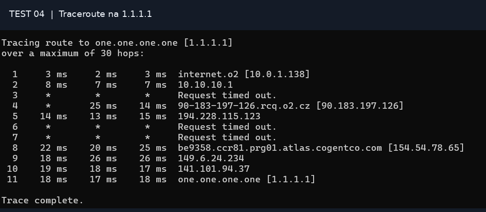

# Dokumentace domácí počítačové sítě

**Home Network Infrastructure – analýza, inventarizace a diagnostika**

**Stav projektu:** Verze 1.0 – dokončeno  
**Datum měření:** 23. 11. 2026  
**Prostředí:** Skutečná domácí síť, Windows, O2 Smart Box 1

---

## 1. O projektu

Cílem projektu bylo analyzovat a zdokumentovat skutečnou domácí počítačovou síť, identifikovat používanou síťovou infrastrukturu, zjistit IP konfiguraci a ověřit funkčnost základních síťových služeb.

Projekt vznikl jako součást mého IT portfolia se zaměřením na počítačové sítě, IT podporu a síťovou administraci.

### Hlavní cíle

- Identifikovat síťový hardware a jeho funkce.
- Provést inventarizaci připojených zařízení.
- Analyzovat IPv4 a IPv6 konfiguraci.
- Ověřit fungování DHCP a DNS.
- Otestovat lokální a internetovou konektivitu.
- Analyzovat směrování paketů pomocí traceroute.
- Vytvořit základní logickou topologii.
- Vyhodnotit výsledky a navrhnout další rozvoj sítě.

**Rozsah verze 1.0:** Základní analýza a diagnostika existující domácí sítě. Kompletní mapování fyzické kabeláže a bezpečnostní audit nejsou součástí dokončeného rozsahu.

---

## 2. Použitá síťová infrastruktura

Domácí síť využívá internetové připojení od poskytovatele O2.

Hlavním síťovým zařízením je **O2 Smart Box 1**, který poskytuje Wi-Fi, ethernetovou konektivitu a základní síťové služby.

Součástí infrastruktury je také **D-Link DGS-108**, osmipo rtový gigabitový neřízený ethernetový switch.

### Identifikovaný hardware

| ID | Zařízení | Funkce | Ověření |
|---|---|---|---|
| R01 | O2 Smart Box 1 | Router, DHCP, DNS, Wi-Fi | Administrace routeru |
| SW01 | D-Link DGS-108 | Gigabitový ethernetový switch | Fotografie zařízení |
| PC01 | Windows PC | Testovací pracovní stanice | `ipconfig /all` |

### Router – O2 Smart Box 1

Zjištěné funkce:

- Výchozí IPv4 brána
- DHCP server
- DNS resolver
- Wi-Fi přístupový bod
- Ethernetové připojení klientů
- Webové administrační rozhraní

**Lokální IPv4 adresa routeru:** `10.0.1.138`

### Switch – D-Link DGS-108

Základní charakteristika:

- 8 ethernetových portů
- Podpora rychlostí 10/100/1000 Mb/s
- Neřízený switch
- Přepínání ethernetových rámců na 2. vrstvě OSI modelu
- Bez běžného webového administračního rozhraní

Přesné kabelové zapojení switche nebylo během projektu ověřeno.

---

## 3. Inventarizace síťových zařízení

Inventarizace byla provedena prostřednictvím administračního rozhraní O2 Smart Boxu.

Použité zdroje:

- Device Map
- Device List
- Windows CMD
- Fyzická kontrola hardwaru

### 3.1 Přehled klientských zařízení

Router v části Device List zobrazoval **9 klientských záznamů**.

| ID | Typ zařízení | Připojení | IPv4 adresa |
|---|---|---|---|
| MOB01 | Android telefon | Wi-Fi | Nezjištěna |
| MOB02 | Android telefon | Wi-Fi | Nezjištěna |
| MOB03 | Android zařízení | Wi-Fi | Nezjištěna |
| MOB04 | Android / Motorola | Wi-Fi | Nezjištěna |
| PC01 | Testovací Windows PC | Wi-Fi | 10.0.1.77 |
| TV01 | Android TV | Ethernet | Nezjištěna |
| PC02 | Počítač | Ethernet | Nezjištěna |
| PC03 | Počítač | Ethernet | Nezjištěna |
| DEV01 | Klient Android-2 | Ethernet | Nezjištěna |

### Souhrn inventarizace

| Kategorie | Počet záznamů |
|---|---|
| Wi-Fi klienti | 5 |
| Ethernet klienti | 4 |
| Celkem | 9 |

Router dále zobrazoval dvě telefonní rozhraní **FXS1 a FXS2**, která nejsou započítána mezi běžné síťové klienty.

### 3.2 Zjištěné nesrovnalosti

Při porovnání Device Map a Device List bylo zjištěno, že obě zobrazení nemusí obsahovat stejná zařízení.

Například iPhone byl viditelný na dřívější síťové mapě, ale v následném seznamu Device List nebyl uveden.

Možné příčiny:

- Zařízení nebylo aktuálně připojeno.
- Router zobrazoval historický záznam.
- Zařízení bylo evidováno pod jiným názvem.
- Zařízení využívalo soukromou Wi-Fi MAC adresu.

Přesná příčina nebyla ověřena.

**Závěr:** Inventarizace představuje zachycený stav administračního rozhraní, nikoli úplný seznam všech existujících zařízení v domácnosti.

---

## 4. Logická topologie domácí sítě

Následující diagram znázorňuje ověřenou část logické topologie domácí sítě.

### Popis topologie

- Hlavní router: O2 Smart Box 1
- Výchozí IPv4 brána: `10.0.1.138`
- Lokální podsíť: `10.0.1.0/24`
- Testovací PC: `10.0.1.77`
- Wi-Fi: 5 klientských záznamů
- Ethernet: 4 klientské záznamy
- Další identifikovaný hardware: D-Link DGS-108

D-Link switch je součástí domácí infrastruktury, ale jeho přesné fyzické zapojení nebylo ověřeno.

Diagram proto představuje logickou strukturu, nikoliv kompletní fyzické propojení kabeláže.

---

## 5. IP adresace a síťové služby

Konfigurace testovacího počítače byla zjištěna příkazem:

`ipconfig /all`

### 5.1 IPv4 konfigurace

| Parametr | Zjištěná hodnota |
|---|---|
| IPv4 adresa PC | `10.0.1.77` |
| Maska podsítě | `255.255.255.0` |
| Prefix | `/24` |
| Adresa sítě | `10.0.1.0` |
| Broadcast | `10.0.1.255` |
| Použitelné adresy | `10.0.1.1–10.0.1.254` |
| Výchozí brána | `10.0.1.138` |
| DHCP server | `10.0.1.138` |
| IPv4 DNS server | `10.0.1.138` |
| DNS suffix | `home` |
| Typ připojení | Wi-Fi |
| Wi-Fi adaptér | Realtek 8852BE Wi-Fi 6 |

Podsíť `10.0.1.0/24` obsahuje 256 IPv4 adres, z nichž 254 je použitelných pro síťová rozhraní.

Tento počet nepředstavuje skutečný DHCP pool routeru.

### 5.2 DHCP

DHCP umožňuje automatické přidělování síťové konfigurace klientským zařízením.

Na testovacím počítači bylo ověřeno:

- DHCP je povoleno.
- DHCP server má adresu `10.0.1.138`.
- Počítači byla přidělena IPv4 adresa `10.0.1.77`.
- Klient získal také výchozí bránu a DNS konfiguraci.

Přesný rozsah DHCP poolu nebyl ověřen.

### 5.3 DNS

DNS zajišťuje překlad doménových jmen na IP adresy.

Testovací počítač má jako IPv4 DNS server nastavený router na adrese `10.0.1.138`.

Funkčnost DNS byla ověřena příkazem:

`nslookup seznam.cz`

Dotaz byl zpracován DNS serverem `internet.o2` přes IPv6. Byly vráceny IPv4 i IPv6 adresy.

### 5.4 IPv6

Na testovacím počítači byly zjištěny:

- Globální IPv6 adresy
- Dočasné IPv6 adresy
- Link-local IPv6 adresa
- IPv6 výchozí brána
- IPv6 DNS server

Globální IPv6 adresy domácích zařízení nejsou v dokumentaci zveřejněny.

---

## 6. Diagnostika a testování sítě

**Datum testování:** 23. 11. 2026  
**Testovací zařízení:** PC01  
**Operační systém:** Windows  
**Nástroje:** CMD, ping, nslookup, tracert

### Přehled výsledků

| Test | Příkaz | Výsledek | Stav |
|---|---|---|---|
| Komunikace s routerem | `ping 10.0.1.138` | 0 % ztráta, průměr 4 ms | PASS |
| Externí IPv4 konektivita | `ping -4 1.1.1.1` | 0 % ztráta, průměr 17 ms | PASS |
| DNS překlad | `nslookup seznam.cz` | Vráceny A a AAAA záznamy | PASS |
| Analýza trasy | `tracert -4 1.1.1.1` | Cíl dosažen na 11. skoku | PASS |

### 6.1 Test komunikace s routerem

**Příkaz:**

`ping 10.0.1.138`

**Výsledky:**

| Metrika | Hodnota |
|---|---|
| Odeslané pakety | 4 |
| Přijaté pakety | 4 |
| Ztráta paketů | 0 % |
| Minimální odezva | 3 ms |
| Maximální odezva | 6 ms |
| Průměrná odezva | 4 ms |

**Výsledek: PASS**

Test potvrdil funkční komunikaci mezi testovacím počítačem a výchozí bránou v okamžiku měření.

**Screenshot testu:**

### 6.2 Test externí IPv4 konektivity

**Příkaz:**

`ping -4 1.1.1.1`

**Výsledky:**

| Metrika | Hodnota |
|---|---|
| Odeslané pakety | 4 |
| Přijaté pakety | 4 |
| Ztráta paketů | 0 % |
| Minimální odezva | 17 ms |
| Maximální odezva | 18 ms |
| Průměrná odezva | 17 ms |

**Výsledek: PASS**

Test potvrdil dostupnost externí IPv4 adresy `1.1.1.1`.

Samotný úspěšný ping však nepotvrzuje kvalitu ani dostupnost všech internetových služeb.

**Screenshot testu:**

### 6.3 DNS diagnostika

**Příkaz:**

`nslookup seznam.cz`

**Výsledky:**

- DNS server úspěšně odpověděl.
- Byly vráceny IPv4 adresy (A záznamy).
- Byly vráceny IPv6 adresy (AAAA záznamy).
- Překlad doménového jména proběhl úspěšně.

**Výsledek: PASS**

**Screenshot testu:**

Globální IPv6 adresa domácího DNS resolveru byla na veřejném screenshotu anonymizována.

### 6.4 Analýza trasy paketů

**Příkaz:**

`tracert -4 1.1.1.1`

**Zjištěné uzly:**

| Skok | IP adresa | Popis |
|---|---|---|
| 1 | `10.0.1.138` | Domácí router |
| 2 | `10.10.10.1` | Privátní síťový uzel |
| 3 | Bez odpovědi | Timeout |
| 4 | `90.183.197.126` | Mezilehlý uzel |
| 8 | `154.54.78.65` | Mezilehlý směrovač |
| 11 | `1.1.1.1` | Cílový server |

**Výsledek: PASS**

Cílové adresy bylo dosaženo na jedenáctém skoku.

Některé mezilehlé směrovače neodpovídaly na diagnostické pakety. To samo o sobě neznamená síťovou poruchu, protože cílová adresa byla úspěšně dosažena.

**Screenshot testu:**

### 6.5 Celkové vyhodnocení diagnostiky

Všechny čtyři základní diagnostické testy byly úspěšné.

Byla potvrzena:

- Komunikace s lokálním routerem.
- Dostupnost externí IPv4 adresy.
- Funkční DNS překlad.
- Úspěšné dokončení traceroute.

Testy představují krátkodobé měření. Nebyla ověřována dlouhodobá stabilita, propustnost připojení ani celkové zabezpečení sítě.

---

## 7. Bezpečnost a omezení analýzy

V rámci této verze projektu nebyly prováděny změny konfigurace routeru ani kompletní bezpečnostní audit.

### Neověřené oblasti

- Použité zabezpečení Wi-Fi
- Nastavení firewallu
- Aktualizace firmwaru
- Vzdálený administrační přístup
- Izolace hostovské sítě
- DHCP pool
- Přesné fyzické propojení sítě

Z těchto důvodů nelze tvrdit, že byla domácí síť kompletně bezpečnostně prověřena.

### Ochrana citlivých údajů

Veřejná dokumentace neobsahuje:

- Hesla a přístupové údaje
- MAC adresy domácích zařízení
- Globální IPv6 adresy domácích klientů
- Úplné zálohy konfigurace routeru
- Osobní identifikátory členů domácnosti

Pro klientská zařízení jsou použita anonymní označení, například PC01, MOB01 a TV01.

---

## 8. Doporučení pro další rozvoj

Na základě provedené analýzy navrhuji následující možnosti rozšíření projektu.

### 8.1 Ověření fyzické topologie

Zmapovat ethernetovou kabeláž, propojení O2 Smart Boxu a D-Link switche a určit využití jednotlivých portů.

### 8.2 Kontrola Wi-Fi zabezpečení

Ověřit šifrování, zabezpečení administračního přístupu a možnosti oddělení hostovských zařízení.

### 8.3 DHCP a adresní plán

Zjistit skutečný DHCP pool a zvážit rezervace IP adres pro vybraná zařízení.

### 8.4 Monitoring

Zavést jednoduché sledování dostupnosti routeru a dalších důležitých zařízení.

### 8.5 Segmentace sítě

V samostatné síťové laboratoři vyzkoušet VLAN a firewall pravidla za použití vhodného routeru a spravovatelného switche.

Tyto body jsou doporučeními pro budoucí rozvoj, nikoliv již provedenými změnami.

---

## 9. Stav projektu

- [x] Identifikace routeru a switche
- [x] Inventarizační snímek klientů z administrace
- [x] Analýza IPv4 konfigurace testovacího PC
- [x] Ověření DHCP a DNS
- [x] Test komunikace s routerem
- [x] Test externí IPv4 konektivity
- [x] DNS diagnostika
- [x] Analýza trasy paketů
- [x] Logická topologie
- [x] Dokumentace výsledků a screenshotů
- [x] Závěrečné technické vyhodnocení

---

## 10. Závěrečné zhodnocení projektu

Během projektu jsem provedl základní analýzu skutečné domácí počítačové sítě a identifikoval její hlavní síťovou infrastrukturu.

Pomocí administrace O2 Smart Boxu jsem získal inventarizační přehled klientských zařízení a rozlišil jejich způsob připojení.

Na testovacím počítači jsem analyzoval IPv4 konfiguraci, výchozí bránu, DHCP server a DNS.

Následně jsem provedl čtyři diagnostické testy pomocí nástrojů Windows CMD. Všechny testy byly úspěšné.

### Získané praktické zkušenosti

- Práce s administračním rozhraním routeru
- Základní síťová inventarizace
- IPv4 adresace a subnetting
- Principy DHCP a DNS
- Diagnostika pomocí `ping`
- Analýza DNS pomocí `nslookup`
- Trasování paketů pomocí `tracert`
- Interpretace výsledků a omezení měření
- Tvorba technické dokumentace
- Práce s Markdownem a GitHubem
